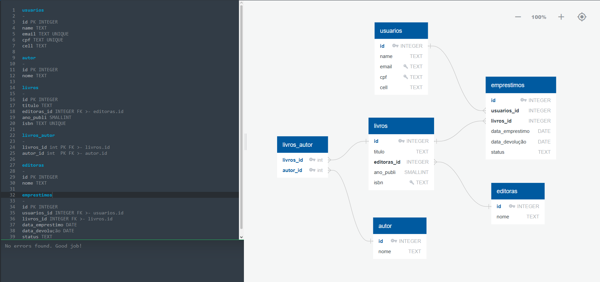

# Sistema de Biblioteca - SQL

Projeto prático para estudo de SQL e modelagem de banco de dados.

## Objetivo

Simular um sistema de biblioteca contendo cadastro de usuários, livros, autores, editoras e controle de empréstimos.

## Diagrama Entidade Relacionamento (DER)

## Tecnologias

- SQL
- SQLite
- DBeaver

## Estrutura do Banco

### Livro
- id (PK)
- titulo
- editora_id (FK)
- ano_publicacao
- isbn (UNIQUE)

### Autor
- id (PK)
- nome

### Livro_Autor
- livro_id (PK, FK)
- autor_id (PK, FK)

Relacionamento N:N entre livros e autores utilizando chave primária composta.

### Editora
- id (PK)
- nome

### Usuario
- id (PK)
- nome
- email (UNIQUE)
- cpf (UNIQUE)
- celular

### Emprestimo
- id (PK)
- cliente_id (FK)
- livro_id (FK)
- data_emprestimo
- data_devolucao
- status

## Regras de Negócio

- CPF único por cliente
- Email único por cliente
- ISBN único por livro
- Status do empréstimo:
  - EMPRESTADO
  - DEVOLVIDO
  - ATRASADO

## Conceitos Aplicados

- PRIMARY KEY
- FOREIGN KEY
- Chave Primária Composta
- Relacionamento N:N
- UNIQUE
- CHECK
- INNER JOIN

## Aprendizados

Durante o desenvolvimento deste projeto foram praticados conceitos de modelagem relacional, integridade referencial, normalização de dados e construção de consultas SQL utilizando relacionamentos entre tabelas.
